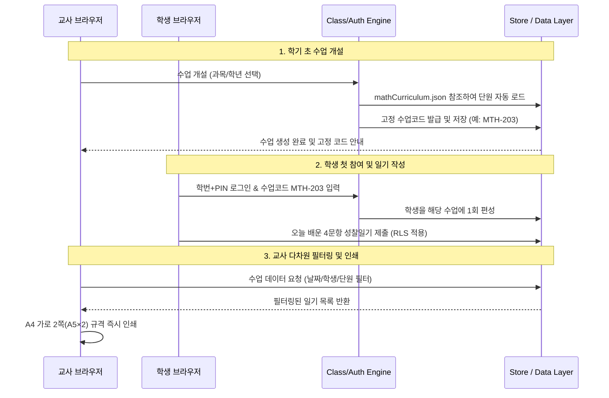

# 아키텍처 정의서 (ARCHITECTURE)

## 1. 개요 및 설계 철학
- **프레임워크**: Next.js (App Router, React 19) + Tailwind CSS + Lucide Icons
- **타이포그래피**: Pretendard 웹폰트 (한글 가독성 최우선), JetBrains Mono (수업코드용 고정폭)
- **UI 테마**: `enforce_light_mode` 규정 준수 (다크모드 전면 배제, 부드러운 오프화이트 #F8FAFC & 차콜 #1E293B & 소프트 블루 #2563EB)
- **아키텍처 원칙**: 데이터와 뷰의 완전 분리, 2022 개정 수학 교육과정 JSON 탑재, 학생 개인정보 및 일기 데이터 RLS/Mock 격리 계층화

## 2. 디렉토리 구조 (규칙 [B]형 표준 준수)

```
수업성찰일기/
├─ PROJECT.md                 # 프로젝트 기본 정보 및 규칙
├─ package.json               # 의존성 및 실행 스크립트
├─ tsconfig.json              # TypeScript 설정
├─ tailwind.config.ts         # 라이트 모드 디자인 토큰 및 인쇄 설정
├─ next.config.ts             # Next.js 환경 설정
├─ 공유용/                     # 최종 배포 및 결과물 안내
├─ docs/                      # 프로젝트 기억 문서
│  ├─ TASKS.md                # 단계별 체크리스트
│  ├─ DECISIONS.md            # 결정 사항 기록
│  ├─ ARCHITECTURE.md         # 아키텍처 명세서 (본 파일)
│  └─ backup/                 # 주요 변경 전 백업
├─ public/                    # 정적 파일
└─ src/
   ├─ app/                    # Next.js App Router (페이지 라우팅 및 레이아웃)
   │  ├─ layout.tsx           # 전역 레이아웃 (Pretendard 폰트, 라이트 배경 주입)
   │  ├─ page.tsx             # 메인 진입점 (모드 선택 및 홈)
   │  ├─ globals.css          # 기본 스타일 및 @media print 규격
   │  ├─ student/             # 학생 화면 라우트 (로그인, 일기 작성, 보관함)
   │  ├─ teacher/             # 교사 화면 라우트 (수업 개설, 3단 필터 대시보드)
   │  └─ print/               # A4 가로 2쪽(A5×2) 인쇄 전용 뷰 라우트
   ├─ components/             # 화면 컴포넌트
   │  ├─ common/              # 공통 UI (버튼, 인풋, 카드, 모달, 뱃지 등)
   │  ├─ student/             # 학생용 UI (4문항 일기 폼, 성찰 타임라인 카드)
   │  ├─ teacher/             # 교사용 UI (수업 개설 모달, 단원 피커, 3단 필터 바)
   │  └─ print/               # A5 바인더/학습지 규격 인쇄 컴포넌트
   ├─ engine/                 # 순수 비즈니스 로직
   │  ├─ auth.ts              # 학번+PIN / Google 인증 및 세션 검증 로직
   │  ├─ classCode.ts         # 고정 수업코드 발급 및 학생 매칭 엔진
   │  └─ filter.ts            # 날짜/학생/단원 다차원 필터링 및 통계 계산 로직
   ├─ store/                  # 상태 관리 및 영속화 (Local / DB 인터페이스)
   │  └─ useJournalStore.ts   # 수업, 학생, 일기 데이터 전역 상태 및 RLS 격리 계층
   ├─ data/                   # 정적 콘텐츠 데이터
   │  └─ mathCurriculum.json  # 2022 개정 초·중·고 수학과 단원/성취기준 데이터셋
   └─ assets/                 # 아이콘 및 정적 리소스
```

## 3. 핵심 모듈 간 데이터 흐름



## 4. 데이터 스키마 정의 (TypeScript)

- **ClassSession (개설 수업)**:
  - `id`: string (UUID)
  - `teacherId`: string
  - `teacherName`: string
  - `name`: string (예: 2학년 3반 수학)
  - `code`: string (예: MTH-203, 고정 코드)
  - `subject`: string (예: 공통수학1)
  - `grade`: string (예: 고등학교 1학년)
  - `activeChapter`: { major: string; minor: string; topic: string }
  - `createdAt`: string

- **StudentProfile (학생 프로필 - 개인정보 최소화)**:
  - `id`: string
  - `studentNumber`: string (예: 20315)
  - `nickname`: string
  - `enrolledClassIds`: string[]

- **ReflectionEntry (성찰 일기 - RLS 격리 대상)**:
  - `id`: string
  - `classId`: string
  - `studentId`: string
  - `studentNumber`: string
  - `studentName`: string
  - `date`: string (YYYY-MM-DD)
  - `chapter`: { major: string; minor: string; topic: string }
  - `answers`: {
      `concept`: string;      // 1. 배운 핵심 개념
      `explained`: string;    // 2. 친구에게 설명하기
      `discovered`: string;   // 3. 새롭게 알게 된 점 / 오개념
      `plan`: string;         // 4. 앞으로의 계획
    }
  - `createdAt`: string
